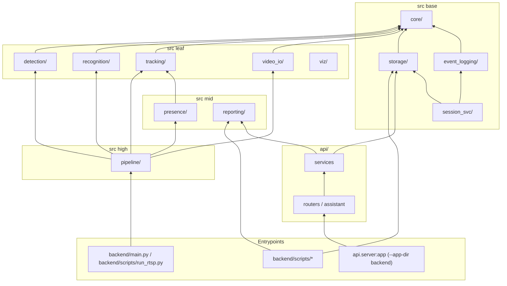
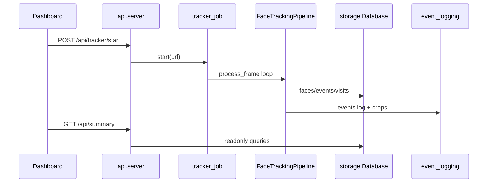

# Architecture — modular layout

Behaviour-preserving package layout introduced on branch `refactor/modular`.
Old import paths remain via module-alias shims (see `src/*.py` files marked deprecated).

## Layer diagram

## Request / data flow

## Rules

- Lower layers never import higher ones (`backend/scripts/check_layers.py`).
- Heavy ML imports stay lazy inside detector / recognizer / appearance / retina constructors.
- Pipeline stays injectable (detector/embedder passed in) for tests without models.
- Do not change log event names, DB schema, API paths, or CLI flags while moving code.
