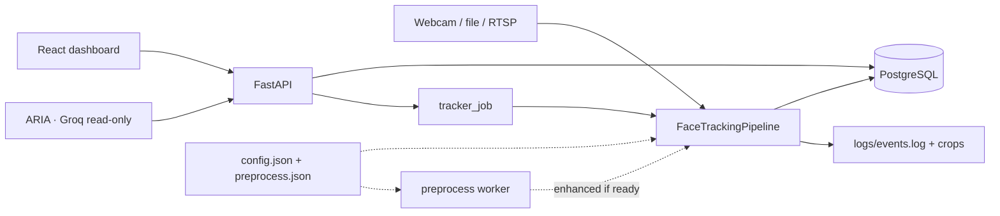
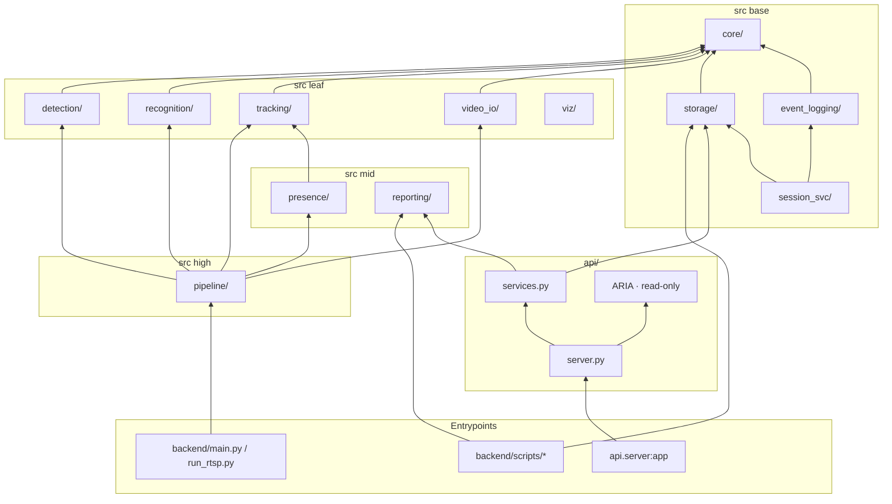
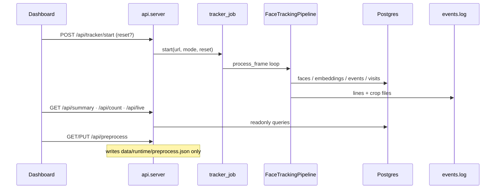
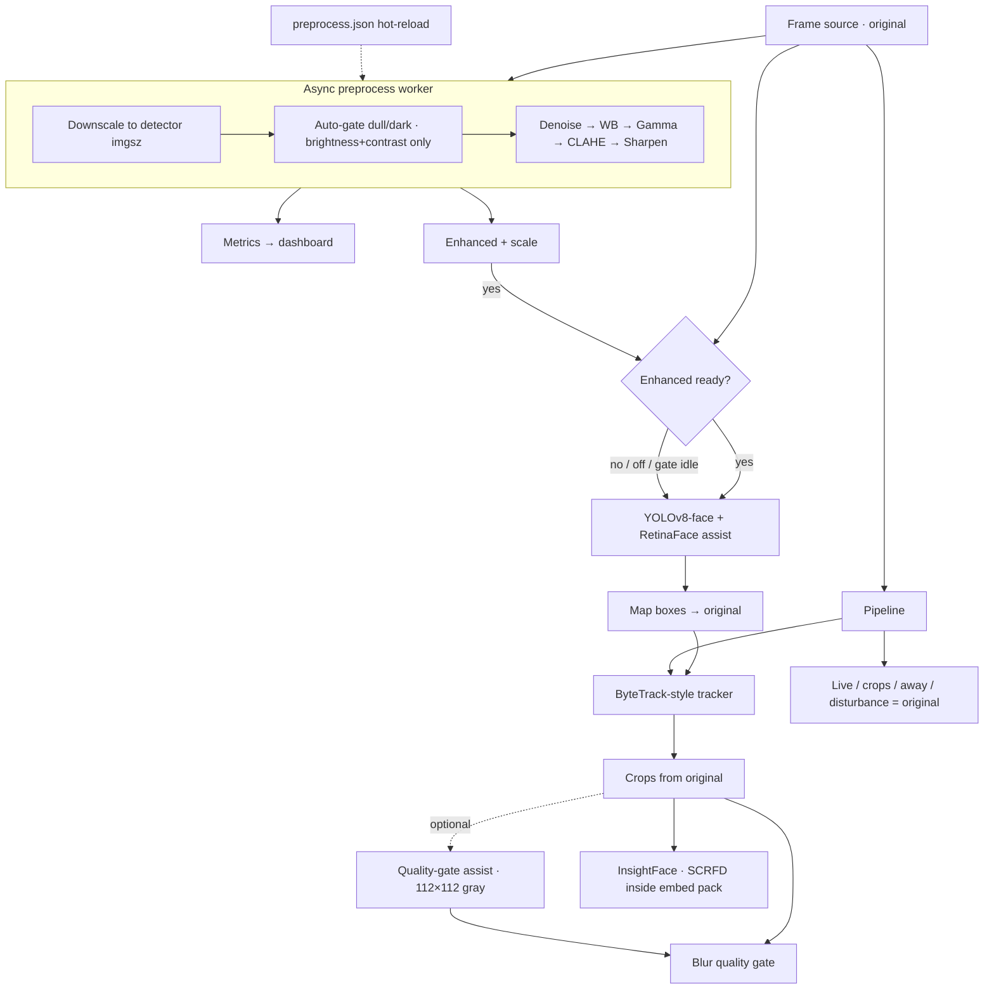

# VYRON — Architecture

End-to-end design for the intelligent face tracker: modular Python backend, FastAPI + React dashboard, optional ARIA assistant, optional detector-only preprocess.

Planning / features / compute: [`PLANNING.md`](PLANNING.md).  
Visual overview: [`assets/vyron-architecture.png`](assets/vyron-architecture.png) (also embedded in the README).

## Design goals

1. **Exactly one ENTRY and one EXIT per visit**; unique visitors = rows in `faces` (re-ID never increments unique).
2. **Identity evidence stays honest** — crops, embeddings, Live Monitor, away, and disturbance always use the **original** frame.
3. **Detector may get help** — optional async preprocess (enhanced if ready, else original; never blocks live).
4. **Observable & reconcilable** — Postgres + `events.log` + crops; `counting.py` / `/api/count` must agree.
5. **Testable without GPUs** — inject fake detector/embedder; heavy ML imports stay lazy.
6. **Clear layers** — lower packages never import higher ones (`backend/scripts/check_layers.py`).

## System context

## Package layers

Behaviour-preserving layout. Prefer package imports (`src.storage`, `src.recognition`, …). Deprecated shims keep old paths working.

| Layer | Responsibility |
|---|---|
| `video_io` | File / webcam / RTSP readers (latest-frame, reconnect) |
| `detection` | YOLOv8-face, RetinaFace assist, optional preprocess worker |
| `tracking` | ByteTrack-style association + coasting |
| `recognition` | InsightFace embeddings + gallery match/register |
| `presence` | Visit state machine (HIDDEN / RESUMED / EXIT) |
| `pipeline` | Orchestrates one frame; owns invariants |
| `storage` / `event_logging` | Postgres + atomic crops + `events.log` |
| `api` + `frontend` | Dashboard, tracker job, preprocess, ARIA |

## Dashboard request flow

## Per-frame identity path

1. Read **original** frame.
2. On detection ticks: optional preprocess → **enhanced if ready, else original**.
3. Detect faces (YOLOv8-face + RetinaFace assist) → **map boxes** to original coordinates.
4. Tracker update → confirmed tracks.
5. Blur / size gate on crop from **original** (optional `quality_assist` only on the 112×112 gray used for blur).
6. Embed + gallery match/register → ENTRY / ownership via presence.
7. Live annotate, away-person, disturbance — always **original**.

## Optional preprocess (detector-only)

**Why not enhance crops/embeddings?** Filters change texture and lighting; the same person would drift in embedding space and saved evidence would no longer match the camera. Detection only needs “find the face”; identity needs a stable original crop.

- Auto-gate measures **dull / dark** (brightness + contrast), not noise.
- `quality_assist` is **not** a frame filter — blur-gate branch only.
- Settings: `config.json` `"preprocess"` ← overridden by `data/runtime/preprocess.json` (~1 s hot-reload).
- API: `GET/PUT /api/preprocess`, `POST /api/preprocess/reset`, `GET /api/preprocess/preview`.
- UI: Configuration card + Live **Original | Enhanced** strip when on.

## Outputs

| Sink | Contents |
|---|---|
| PostgreSQL | `faces`, `embeddings`, `events`, `visits` (+ away_*) |
| `logs/events.log` | Session audit (`sid=` on every line) |
| `logs/away_events.log` | AWAY_* when separated |
| `logs/{entries,exits,faces}/YYYY-MM-DD/` | Crop JPEGs |
| Dashboard KPIs | Unique, Entries, Exits, Inside (+ count audit) |
| ARIA | Read-only Q&A over the same APIs (no images/embeddings to Groq) |

Write order per event: **crop → DB transaction → log line**.

## ARIA (optional)

- Groq chat over SSE; tools call `api/services` / `assistant_tools` (read-only).
- Live KPI snapshot injected each turn.
- Whitelist inline tags and nav actions only.
- Never changes tracker, DB, or preprocess settings.
- Disabled cleanly without `GROQ_API_KEY`.

## Rules for changes

- Lower layers never import higher ones.
- Do not rename log events, API paths, or CLI flags casually.
- Schema changes need a migration in `Database._migrate` / `schema.py`.
- Prefer explaining invariants and thresholds over narrating every line.
